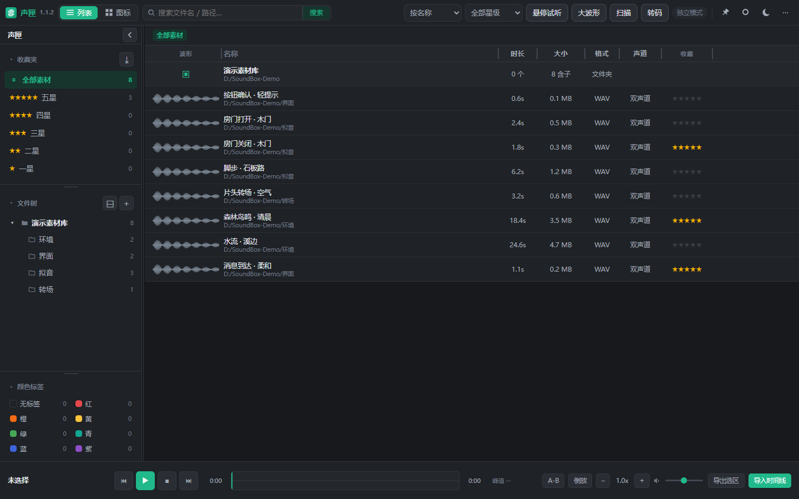
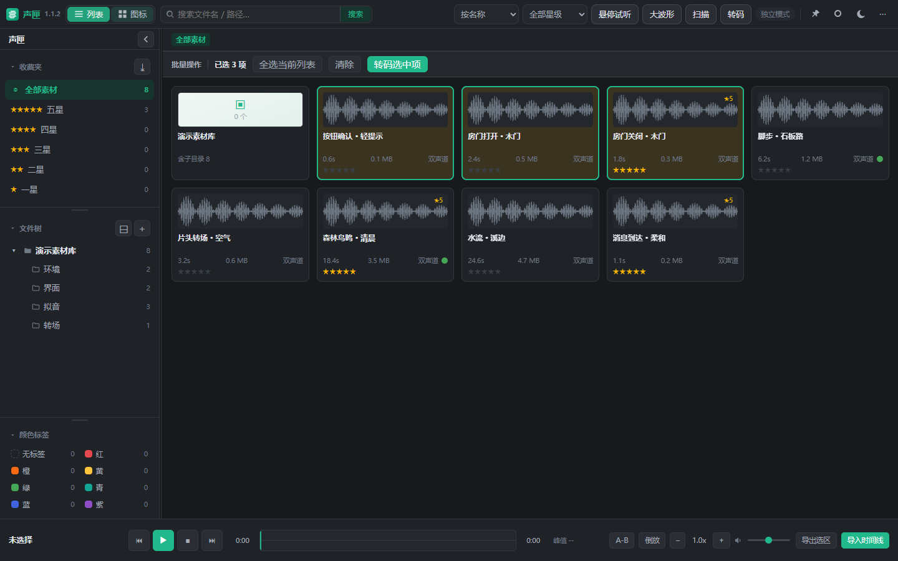
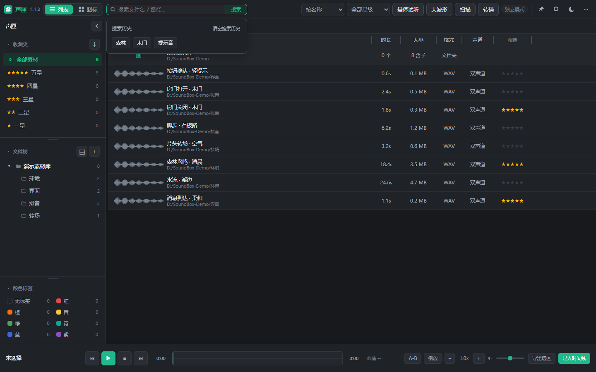

# 声匣 SoundBox · 达芬奇插件与独立版下载

**声匣 SoundBox 是一款可独立运行、也可与 DaVinci Resolve 配合使用的音频素材管理与预览工具。用户可在独立界面整理、搜索和试听音频，将所选音频导入达芬奇项目媒体池或时间线；同时支持批量音频转码、波形定位、选区导出、星级收藏及颜色标签整理。**

Windows 64 位版本。可独立运行，也可从 DaVinci Resolve「工作流整合」启动。

## 下载与分享

- **[最新版本下载页](https://github.com/Pawaganti/SoundBox-Resolve-Downloads/releases/latest)**：适合长期收藏和分享。
- [v1.1.2 版本记录](https://github.com/Pawaganti/SoundBox-Resolve-Downloads/releases/tag/v1.1.2)
- **[下载安装版 Setup.exe](https://github.com/Pawaganti/SoundBox-Resolve-Downloads/releases/download/v1.1.2/SoundBox-v1.1.2-Setup-x64.exe)**：带安装向导、快捷方式和卸载入口。
- **[下载便携版 ZIP](https://github.com/Pawaganti/SoundBox-Resolve-Downloads/releases/download/v1.1.2/SoundBox-v1.1.2-win32-x64.zip)**
- [SHA-256 校验文件](https://github.com/Pawaganti/SoundBox-Resolve-Downloads/releases/download/v1.1.2/SHA256SUMS.txt)

本仓库及下载包公开可访问，访问者无需加入私有仓库；通常不需要登录 GitHub。

## 安装与使用

### 安装版（推荐）

1. 下载 `SoundBox-v1.1.2-Setup-x64.exe`，双击并按安装向导操作。默认程序目录为 `C:\SoundBox\build\SoundBox-win32-x64`。
2. 安装会写入完整运行文件，建立桌面、开始菜单快捷方式和 Windows 卸载入口。重新安装保留当前 Windows 用户的配置。
3. 检测到 DaVinci Resolve 或既有声匣集成目录时，安装包同步配置工作流启动入口；重启 Resolve 后，从「工作区 → 工作流整合 → 声匣」打开。
4. 若安装目录或达芬奇公共插件目录提示无写入权限，关闭安装程序，右键安装包选择「以管理员身份运行」。安装后从自己的桌面启动声匣，不要切换 Windows 用户。

### 便携版

1. 下载 `SoundBox-v1.1.2-win32-x64.zip`，完整解压后双击 `SoundBox.exe`。这不是安装向导版。
2. 保留旁边的运行库和 `resources` 文件夹；`Create-Desktop-Shortcut.ps1` 可创建桌面快捷方式。
3. 达芬奇集成：在声匣更多菜单中执行安装到 DaVinci Resolve，按提示完成并重启 Resolve。移动便携目录后需重新执行集成安装。

### 配置与卸载

两种包的应用功能相同。配置、收藏、标签、搜索历史和素材索引继续使用 `%APPDATA%\soundbox\`，安装程序不覆盖或删除此目录。个人音频文件不随安装包分发。重装前建议自行备份该目录。

安装版可从 Windows「设置 → 应用 → 已安装的应用」卸载，用户配置保留。便携版没有安装卸载入口；不再使用时关闭程序并移除解压目录。达芬奇入口不再使用时，可移除 `C:\ProgramData\Blackmagic Design\DaVinci Resolve\Support\Workflow Integration Plugins\com.local.AudioPreview`。

独立试听、搜索及转码无需打开 Resolve。时间线插入需要先打开 Resolve 项目和时间线，并确认连接状态。

## 主要功能

- 文件夹树、列表／图标视图、目录底色与 Ctrl／Shift 多选。
- 子文件夹搜索、搜索历史、完整父目录路径排序、星级与颜色标签筛选。
- 悬停试听、波形点击定位、倍速／倒放、A-B 选区与导出。
- 导入达芬奇媒体池或播放头位置；优先复用可用轨道，重叠时新建 Stereo 轨道。
- 常见音频转码、同名保护、置顶与无阴影悬浮按钮。

## 界面预览

以下是 v1.1.2 演示素材库截图，波形为构造数据，不包含个人音频资料。

| 图标与批量操作 | 搜索历史 |
| --- | --- |
|  |  |

悬浮按钮：

## v1.1.2

- 2026-10-30 补充真正的 Setup.exe 安装版；原 ZIP 保留并明确标为便携版。应用代码与版本号不变。
- 安装版已在现有电脑覆盖安装并启动；91 个运行文件校验一致，首次启动前 4,665 个用户配置／缓存文件未改变。

- 去掉悬浮按钮普通、悬停、按下状态的阴影。
- 内部统一图标由 26px 放大到 40px，保留白色圆角按钮。
- 保留中性灰色「批量操作」栏及此前稳定性修复。
- 22 项界面回归通过。Resolve 插入经过隔离模拟，本次未在真实工程中逐项验收。

本仓库用于公开下载与版本说明，不提供单独的源码归档包。源码归档继续保留在私有仓库。
